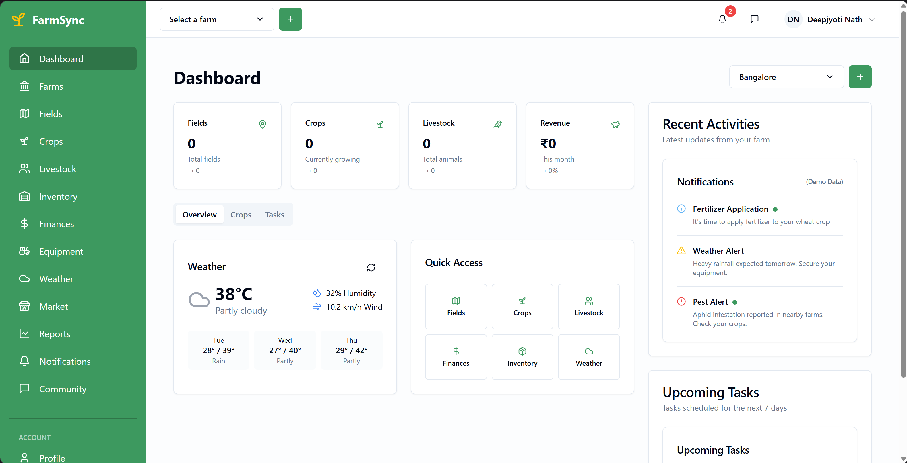

<div align="center">

# FarmSync

**Open-source farm management for smallholders, family farms and cooperatives.**

Map your fields, track crops and livestock, record costs and harvests, connect sensors,
and run a cooperative from one installable web app that keeps working on patchy connections.

[](https://github.com/deepjyoti31/farmsync/actions/workflows/ci.yml)
[](LICENSE)
[](CONTRIBUTING.md)

[Getting started](docs/getting-started.md) ·
[Documentation](docs/README.md) ·
[Roadmap](docs/roadmap.md) ·
[Contributing](CONTRIBUTING.md)



</div>

## Why FarmSync

Most farm software is built for large commercial operations, priced in dollars per acre, and assumes a fast connection.
FarmSync is designed the other way round:

- **Free and self-hostable.** MIT licensed, runs on a free Supabase project and any static host.
- **Works offline.** Installable as a Progressive Web App; cached data stays available without a signal.
- **Local units and languages.** Acres, hectares and bigha; quintals and tonnes; English, Hindi, Spanish, French, Chinese and Arabic (with right-to-left layout).
- **Built for groups.** Farms can belong to a team or cooperative with owner, admin, editor and viewer roles, enforced in the database.

## Features

| Area | What you can do | Status |
| --- | --- | --- |
| Farms and fields | Draw farm boundaries on a satellite map, with automatic area and GPS centre; manage fields and soil data | Stable |
| Crops | Plan and track plantings through planted, growing and harvested; record harvest quantities | Stable |
| Livestock | Register animals by type, breed, tag and status | Beta |
| Inventory and equipment | Stock levels with low-stock and expiry warnings; equipment register | Stable |
| Finances | Income and expense tracking by category; profit and loss charts | Stable |
| Weather | Current conditions and 5-day forecast for each farm | Stable |
| IoT sensors | Register devices, ingest readings over HTTPS, chart live telemetry | Beta |
| Analytics and reports | Financial health, yield per hectare by crop, exportable reports | Beta |
| Market | Mandi price board, produce marketplace listings and buyer inquiries, supplier directory | Beta |
| Community | Discussion forums and expert tips | Beta |
| Cooperatives | Member farms, crop mix, bulk input orders, produce batches for traceability | Beta |
| Financial services | Loan and insurance records, indicative credit score | Beta |
| Sustainability and compliance | Input and water logs, CSV export for audits, automated banned-input checks | Beta |

"Beta" means the feature works end to end but has known gaps listed in the [roadmap](docs/roadmap.md).

## Quick start

You need **Node.js 18.18+** (20 recommended) and a free **[Supabase](https://supabase.com)** project.
A [Mapbox](https://www.mapbox.com) token enables maps and a [WeatherAPI.com](https://www.weatherapi.com) key enables forecasts; both have free tiers.

```bash
git clone https://github.com/deepjyoti31/farmsync.git
cd farmsync
npm install
cp .env.example .env   # then fill in your keys
```

Apply the database schema to your Supabase project:

```bash
npx supabase login
npx supabase link --project-ref <your-project-ref>
npx supabase db push
```

Start the app:

```bash
npm run dev
```

Open <http://localhost:8080> and create an account. The full walkthrough, including the weather function and troubleshooting, is in **[docs/getting-started.md](docs/getting-started.md)**.

## Tech stack

| Layer | Technology |
| --- | --- |
| Frontend | React 18, TypeScript, Vite, React Router |
| UI | Tailwind CSS, shadcn/ui (Radix UI), Recharts, Lucide icons |
| Data fetching | TanStack Query with local persistence for offline reads |
| Maps | Mapbox GL JS, Mapbox GL Draw, `@mapbox/geojson-area` |
| Backend | Supabase: PostgreSQL with Row Level Security, Auth, Edge Functions (Deno) |
| Internationalisation | i18next with lazy-loaded translation files |
| Offline | `vite-plugin-pwa` (Workbox) |
| Quality | ESLint, TypeScript, Vitest, SQL RLS tests, GitHub Actions |

## Scripts

| Command | Description |
| --- | --- |
| `npm run dev` | Start the dev server on port 8080 |
| `npm run build` | Production build into `dist/` |
| `npm run preview` | Serve the production build locally |
| `npm run lint` | ESLint |
| `npm run typecheck` | TypeScript type check |
| `npm test` | Unit tests (Vitest) |
| `npm run check` | Lint, typecheck, test and build in one go; run before opening a PR |
| `npm run db:types` | Regenerate `src/integrations/supabase/types.ts` from a local Supabase database |
| `scripts/test-db.sh` | Apply all migrations to a throwaway Postgres and run the RLS tests |

## Project structure

```text
farmsync/
├── public/                 Static assets, PWA icons, translation files (public/locales/<lang>)
├── src/
│   ├── components/         Feature components (crops, farms, maps, layout, ...) and ui/ primitives
│   ├── contexts/           AuthContext: session, organizations and the user's role
│   ├── hooks/              Shared React hooks
│   ├── integrations/       Supabase client and generated database types
│   ├── lib/                Pure, unit-tested logic (yield maths, market prices, telemetry, CSV, ...)
│   ├── pages/              One component per route, lazily loaded
│   └── types/              Shared TypeScript types
├── supabase/
│   ├── functions/          Edge functions: get-weather, ingest-telemetry
│   ├── migrations/         SQL migrations, applied in filename order
│   └── tests/              RLS regression tests
├── scripts/                Developer scripts
└── docs/                   Project documentation
```

## Documentation

- [Getting started](docs/getting-started.md): local setup from zero
- [Architecture](docs/architecture.md): how the app is put together
- [Database and security](docs/database.md): schema, access model, migrations
- [IoT integration](docs/iot-integration.md): sending sensor data to FarmSync
- [Deployment](docs/deployment.md): hosting the app and edge functions
- [Roadmap](docs/roadmap.md): what is planned next

## Contributing

Contributions of all sizes are welcome, from translations and bug reports to new modules.
Read [CONTRIBUTING.md](CONTRIBUTING.md) to get set up, and please follow the [Code of Conduct](CODE_OF_CONDUCT.md).

## Security

Please report vulnerabilities privately as described in [SECURITY.md](SECURITY.md), not in public issues.

## License

FarmSync is released under the [MIT License](LICENSE).
