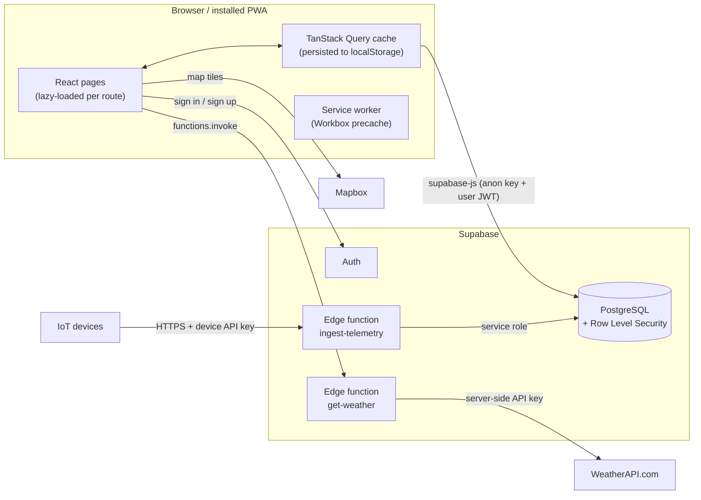

# Architecture

FarmSync is a single-page React application backed by Supabase. There is no custom application server:
the browser talks to Supabase directly, and PostgreSQL Row Level Security decides what each user may read or write.
Two small edge functions handle the cases where a secret must stay on the server.

## Frontend

| Concern | Where | Notes |
| --- | --- | --- |
| Entry point | `src/main.tsx` | Shows a setup screen if Supabase env vars are missing, otherwise loads `App` |
| Routing | `src/App.tsx` | Public routes (`/landing`, `/login`, `/signup`) and protected routes under `/dashboard`. Every page is `React.lazy` loaded |
| Layout | `src/components/layout` | Sidebar, top bar, organization switcher, notifications, language switcher |
| Auth and tenancy | `src/contexts/AuthContext.tsx` | Session, the user's organizations, the selected organization and the user's role in it |
| Data access | `@tanstack/react-query` + `src/integrations/supabase/client.ts` | Queries call Supabase directly; query keys include the selected farm so switching farms refetches |
| Pure logic | `src/lib` | Unit conversion, yield maths, market price summaries, telemetry shaping, CSV export, date ranges, compliance checks. Covered by Vitest |
| UI primitives | `src/components/ui` | shadcn/ui components. Treat as vendored code; prefer composing over editing |

### Conventions

- **Pages own their queries.** A page fetches what it shows with `useQuery`, keyed by the inputs that change the result (for example `['analytics_yield', selectedFarmId]`). Mutations invalidate the matching keys.
- **Business rules go in `src/lib`.** If logic can be expressed as a function of plain data, put it in `src/lib` with a test, and keep the component thin. This is how yield per hectare, loan EMIs and market trends are implemented.
- **Generated types.** `src/integrations/supabase/types.ts` mirrors the database schema. Regenerate it after a migration rather than editing it by hand.
- **No fake data in the UI.** When a table is empty, show an empty state that explains how to add data. Where sample data is unavoidable (the mandi price board before prices are loaded) it is visibly labelled.

## Multi-tenancy and roles

Every user gets a **personal workspace** (an `organizations` row with `is_personal = true`) when they sign up. Users can create **team** organizations, such as a family farm or a cooperative, and invite others with one of four roles:

| Role | Read farm data | Write farm data | Manage loans and insurance | Manage members |
| --- | --- | --- | --- | --- |
| owner | Yes | Yes | Yes | Yes |
| admin | Yes | Yes | Yes | Yes |
| editor | Yes | Yes | No | No |
| viewer | Yes | No | No | No |

A farm belongs to the user who created it and optionally to one organization. Members of that organization get access according to their role. These rules are enforced by RLS policies in the database, not just hidden in the UI. See [database.md](database.md) for details.

## Offline behaviour

- The service worker precaches the app shell and all route chunks, so the app opens without a connection once installed.
- TanStack Query persists its cache to `localStorage` for 24 hours, so previously viewed lists and dashboards render offline.
- Writes currently require a connection. Queued offline writes are on the [roadmap](roadmap.md).

## Internationalisation

Translations live in `public/locales/<lang>/translation.json` and are loaded on demand by `i18next-http-backend`. The language is detected from the query string, cookie, local storage or browser, and Arabic switches the document to right-to-left via `useDirection`. Not every page is translated yet; new user-facing strings should be added to the English file and referenced with `t()`.

## Edge functions

| Function | Called by | Purpose |
| --- | --- | --- |
| `get-weather` | Weather page and dashboard widget, with the user's JWT | Proxies WeatherAPI.com so the API key never reaches the browser |
| `ingest-telemetry` | IoT devices | Authenticates a device by its API key and inserts a telemetry row using the service role. See [iot-integration.md](iot-integration.md) |

## Build

Vite produces hashed, code-split assets. Large libraries (Mapbox GL, Recharts, Supabase, React) are split into separate long-cached chunks configured in `vite.config.ts`, so the initial download is around 130 kB of application JavaScript plus shared vendor chunks, and Mapbox is fetched only on pages that show a map.
